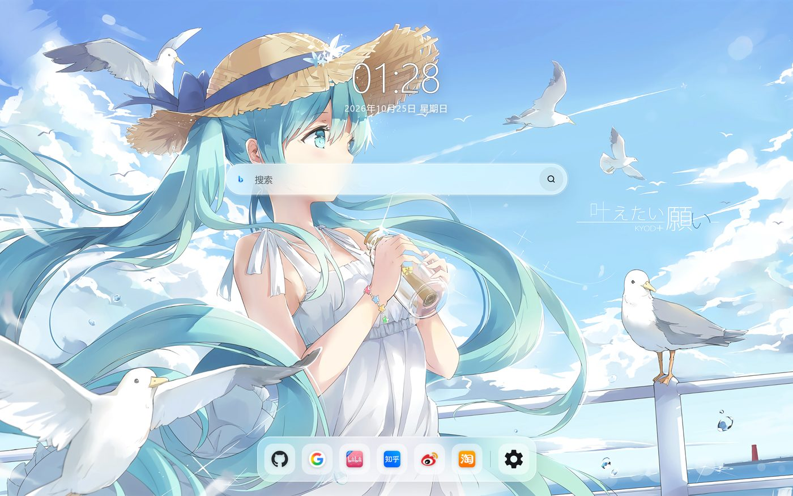
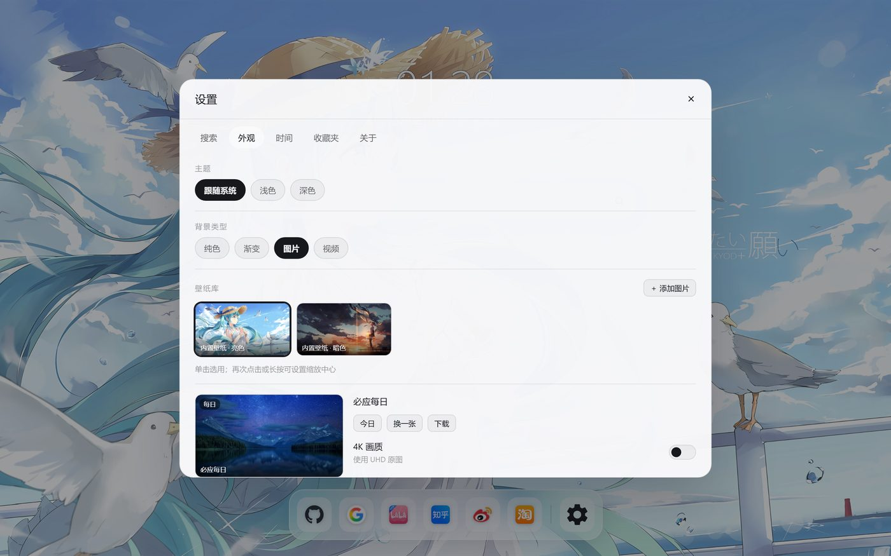
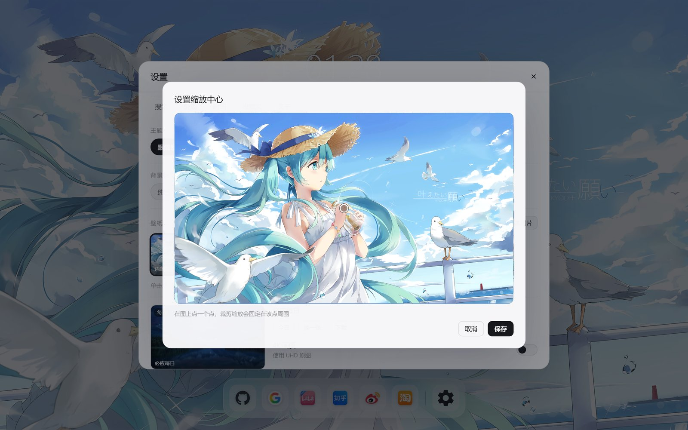

# 随缘搜索 · SuiYuan Search

一个简洁的浏览器起始页：大时钟、胶囊搜索、底部 Dock、壁纸背景。纯静态实现，既能当网页打开，也能直接作为 Chrome / Edge 扩展加载。

## 截图

<p align="center"></p>

<p align="center"></p>

<p align="center"></p>

## 使用

### 当网页用

直接双击 `index.html`，或部署到任意静态托管（GitHub Pages / Nginx / OSS）。
所有设置存在浏览器本地，背景图片/视频存在 IndexedDB。

### 当扩展用

1. 打开 `chrome://extensions`（Edge 是 `edge://extensions`）
2. 开启「开发者模式」→「加载已解压的扩展程序」→ 选择本目录
3. 新标签页即为此页面；点扩展图标会另开一页

## 功能

- 大时钟：固定 76px，不随窗口缩放；字重可选细/常规/粗；两个冒号同步闪烁；日期 16px（移动端 14px）独立字号
- 搜索：必应 / 谷歌 / 百度，支持自定义引擎（URL 用 %s 占位），Ctrl+1~9 快速切换
- 搜索联想：Bing + 百度 + Google 多源，谁先返回谁先显示；网页版另走百度 JSONP，全部失效才回退本地
- 搜索历史：空搜索框聚焦时显示最近 12 条，可在设置关闭或一键清空
- 界面语言：自动（系统）/ 中文（简繁）/ 英 / 法 / 俄 / 西 / 阿拉伯，阿拉伯语自动 RTL
- 主题：跟随系统（默认）/ 浅色 / 深色；遮罩、文字、背景色随主题联动，点击时间或日期可快速切换
- 壁纸库：内置亮/暗 + 本地图片，网格展示；必应每日用分割线单独分区，左侧预览、右侧信息与操作
- 时钟/搜索框/Dock 尺寸固定，不随窗口宽度缩小；设置面板按 4:3（竖屏 3:4）等比缩放
- 视频壁纸库：支持一次上传多个视频，卡片预览、选用与删除；视频背景时自动关闭毛玻璃并用纯色玻璃
- 视频背景会隐藏图片层；自动播放被拦或编码不支持时会提示，不会出现「看起来还是图片」
- 选中任意壁纸会自动切到「图片/视频」背景类型，不会出现选了没反应
- 每张壁纸可设缩放中心（再次点击或长按卡片，在图上点选），裁剪时固定在该点周围
- 必应每日：自动更新、有预览、可切 4K、可下载；网页版跨域时退回直出图接口
- Dock：图标区可横向滚动，设置按钮固定在右侧；放不下时在设置前出现「…」展开全部；搜索框与 Dock 保留毛玻璃
- 网站图标全自动获取：站点 favicon → favicon.im CDN 兜底 → 都取不到时显示彩色首字母，不内置任何站点图标
- 收藏夹：增删改、排序、导入导出 JSON
- 快捷键：`/` 或 `Ctrl+K` 聚焦搜索，`Esc` 关闭面板

## 目录

```
index.html          页面结构（含设置面板、弹窗）
style.css           全部样式
js/core.js          存储、旧设置迁移、媒体读写
js/app.js           时钟、搜索、Dock、设置等交互
local-storage.js    IndexedDB 媒体存储
manifest.json       扩展清单（MV3）
background.js       点扩展图标时打开页面
img/                图标与默认壁纸
legacy/             旧版实现（Vue 版与更早的原生版），不参与运行
```

## 配置备份

设置 → 关于 → 配置备份，可导出/导入 JSON；勾选「包含图片 / 视频文件」会把媒体一起写进 JSON（体积较大）。

## 数据兼容

- 设置沿用 `chrome.storage.sync` 的 `suiYuanSettings`；网页版用 `localStorage`
- 收藏夹沿用 `bookmarks`
- 旧版字段（`searchEngine`、`imageLight`、`titleDisplay` 等）会自动迁移

## 许可

见 LICENSE。
